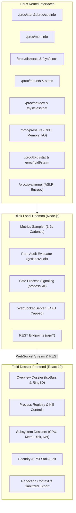

# Blink // Field Dossier — Linux Host Telemetry & Process Controller

[](https://www.npmjs.com/package/@sivnsh7/blink)
[](https://opensource.org/licenses/MIT)
[](https://nodejs.org/)
[](https://kernel.org/)

A local-first, low-overhead Linux host telemetry, kernel security audit, and process management dashboard. Built with React 19, Vite, Express, and WebSocket, sampling Linux virtual filesystems (`/proc`, `/sys`) with zero external charting bloat, brutalist precision, and classified redaction.

---

## Quick Start (Run Instantly)

Run without installation via `npx`:

```bash
npx @sivnsh7/blink
```

Or install globally:

```bash
npm install -g @sivnsh7/blink
blink
```

Open your browser to `http://127.0.0.1:3002`.

---

## Aesthetic Identity: Sivnsh7 "Field Dossier" Design Language

Blink is designed around the tactile **Sivnsh7 "Field Dossier"** visual language—departing from modern SaaS flat design and neo-cyberpunk tropes to deliver an authoritative, investigative instrument:

- **Brutalist Structure & Zero-Blur Elevation:** Hard black `2.5px` borders with crisp offset directional drop-shadows (`3px`, `6px`, `9px`) and zero blur, simulating physical stacked cards on a workbench.
- **Paper Skeuomorphism:** Ivory linen (`#F1EBDC`) light canvas transitioning to pitch-black AMOLED (`#000000`) dark mode, procedural dual radial-gradient paper grain, and skeuomorphic folded corner cards (`.card--fold`).
- **Tactile Clay & Lacquer Controls:** Signature lacquer-red CTA plates with inset bevel highlights and active press depressions.
- **Classified Redaction Motif:** Redaction bars (`.redact[data-note]`) masking sensitive PIDs, system hostnames, and network addresses, backed by a global reveal registry and screen-reader accessibility filters.
- **3D Struck-Brass Hero Masthead:** Real-time pointer parallax tilt, Euclidean proximity lift, and asynchronous Katakana scramble glitch loop running on pure CSS transforms and lightweight requestAnimationFrame.
- **Typographic Discipline:** Strict three-tier hierarchy combining **Bricolage Grotesque** (editorial display mastheads), **Space Grotesk** (body and subheads), and **IBM Plex Mono** (tabular metadata, proof strips, coordinates, and status stamps).

---

## Capabilities & Architecture



### 1. Linux Pressure Stall Information (PSI)
Real-time monitoring of `/proc/pressure/cpu`, `/proc/pressure/memory`, and `/proc/pressure/io`. Tracks `avg10`, `avg60`, `avg300`, and cumulative stall microseconds. Accurately reports `supported: false` on kernels lacking PSI compilation without fabricating misleading `NOMINAL` states.

### 2. Physical Disks vs Filesystems Separation
Physical block storage devices (`/sys/block` entries like `sda`, `nvme0n1`, `vda`) and mounted filesystem partitions (`/proc/mounts`) are partitioned into independent data models. Eliminates capacity double-counting and identifies the primary root filesystem (`isRoot: true`).

### 3. Truthful Memory Instrumentation
Memory utilization is computed as `MemTotal - MemAvailable`, correctly accounting for reclaimable page cache and slab memory. Virtual address space commitments (`Committed_AS` and `CommitLimit`) are tracked independently.

### 4. Process Registry & Safe Termination
Monitors the top 100 active tasks sampled from `/proc/[pid]/stat`. Provides interactive process termination with:
- **System PID 1 & Non-Positive PID Protection:** Terminating init/systemd (PID 1) or non-positive PIDs is strictly prohibited.
- **Daemon Self-Protection:** Terminating the Blink server process itself is rejected.
- **Kernel Task Immunity:** Detects `PF_KTHREAD` flags and `kthreadd` (PPID 2) parentage to block termination attempts against kernel threads.
- **Strict Signal Whitelist:** Supports `SIGTERM` (Graceful), `SIGKILL` (Force), and `SIGINT`.
- **Cross-Site Request Forgery (CSRF) Guard:** Validates the browser `Origin` header against `allowedOrigins` on mutating HTTP calls.

### 5. Presentation Redaction & Sanitized Exports
Global masking toggle has strict authority over per-item reveals. When exporting telemetry snapshots to `.json`, Blink automatically sanitizes hostnames, scrubs non-kernel process identifiers to `proc-[pid]`, redacts command lines, and masks MAC addresses.

---

## Security & Operational Scope

> [!IMPORTANT]
> **Read-Only Default & Local-First Monitoring:** Blink is designed for local developer workstation observability and Linux performance analysis.
> 
> - **Loopback Isolation:** The server binds to `127.0.0.1` by default. While `HOST` can be overridden via environment variables, endpoints do not implement enterprise authentication. Exposing Blink on public networks without an authenticating reverse proxy (like Nginx, Caddy, or WireGuard) is strongly discouraged.
> - **Zero Shell Spawning:** Telemetry collectors never spawn shell commands (`execSync`, `sh`, `awk`, `grep`) during polling loops. All reads are performed directly on `/proc` and `/sys` virtual filesystems.
> - **Presentation-Layer Redaction:** Redaction features prevent accidental over-the-shoulder disclosure and unscrubbed file sharing; they do not represent cryptographic boundary isolation.

---

## API Endpoints

| Method | Path | Description | Safety Constraints |
|---|---|---|---|
| `GET` | `/api/health` | Agent health, capabilities, and schema metadata | Open |
| `GET` | `/api/snapshot` | Complete host telemetry snapshot (CPU, memory, storage, network, processes, PSI) | Read-only |
| `GET` | `/api/audit` | Pure heuristic security & stability scorecard without mutating sampling baselines | Read-only |
| `POST` | `/api/processes/:pid/kill` | Send POSIX signals (`SIGTERM`, `SIGKILL`, `SIGINT`) to a process | Origin-checked, PID 1 & Kernel protected |
| `WS` | `/ws` | Real-time continuous telemetry stream (1.2s interval) | Exact Origin checked, 64 KB payload cap |

---

## Development & Build

### Prerequisites
- Linux OS with kernel 4.20+ (Arch Linux, Ubuntu, Debian, Fedora, RHEL, etc.)
- Node.js 20+ and npm

### Local Development Setup
```bash
git clone https://github.com/sivnsh7/blink.git
cd blink
npm install
npm run dev
```

Vite dev server will start on `http://127.0.0.1:5173` with proxying to the backend daemon on `127.0.0.1:3002`.

### Production Build & Verification
```bash
# Run unit test suite
npm test

# Build client production bundle into server/public
npm run build

# Start production server
npm start
```

---

## Contributors & Acknowledgements

Blink was engineered and audited through a multi-model collaborative development effort:

- **[Sivnsh7](https://github.com/sivnsh7)** — Creator, Lead Architect & Author of the Sivnsh7 "Field Dossier" Design Language.
- **Google Antigravity** — Advanced Agentic AI Engineering, Deep Audit Remediation, Core Linux Collectors & Safety Guardrails.
- **Claude (Anthropic)** — Reverse Engineering, Brutalist UI Implementation & Typographic Structure.
- **NVIDIA Nemotron** — High-Performance Host Telemetry & Hardware Systems Optimization.
- **Agnes** — Security Review, Linux PSI Kernel Calibration & Quality Assurance.
- **Open Source Community** — Linux kernel sysfs/procfs documentation, testing, and feedback.

---

## License

[MIT License](LICENSE.txt) © 2026 Sivnsh7 and Blink contributors.
